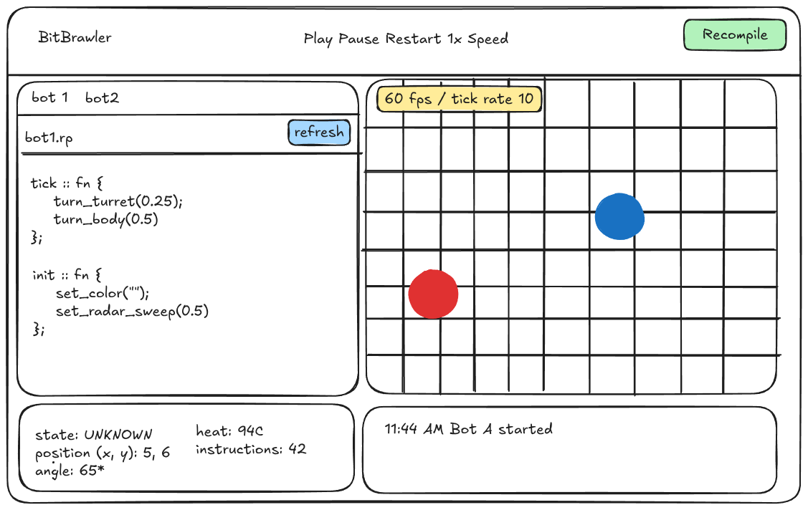

# bitbrawler

robot combat arena where each robot is written in Ripe and compiled before match.

i'll be tiny Ripe programs fight in a simulation

- robot decision logic
    - fire(), move(), tick(), etc
- executed live in arena
- abi
- ticket budget / sandbox
- switching between bot
- hot reloading (?)
- max Y instr per tick
